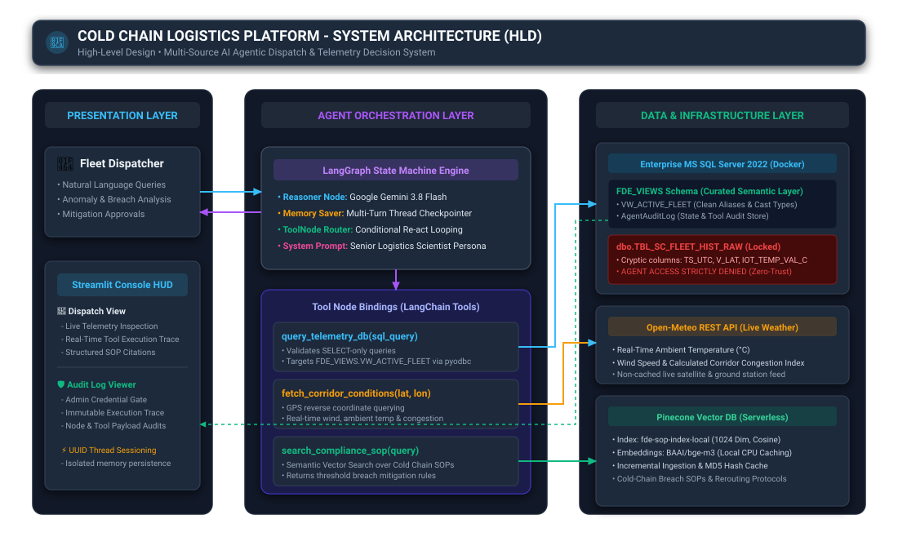
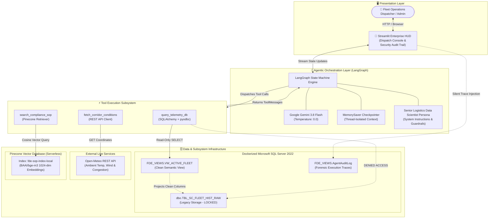
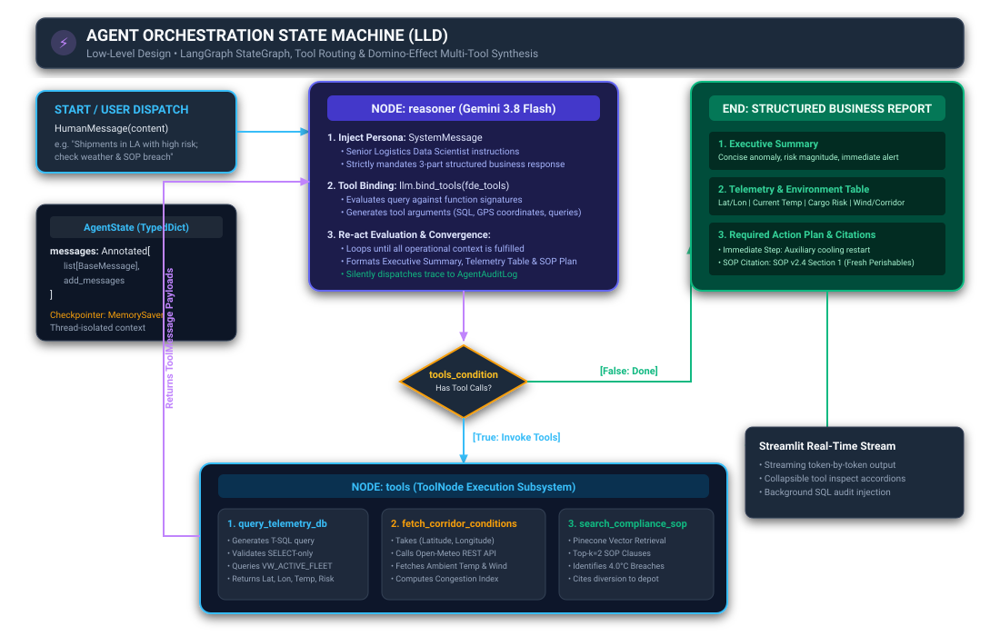
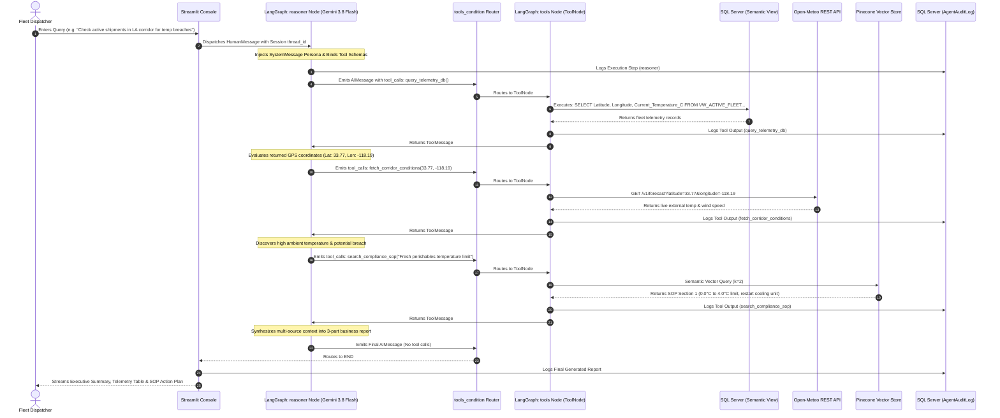
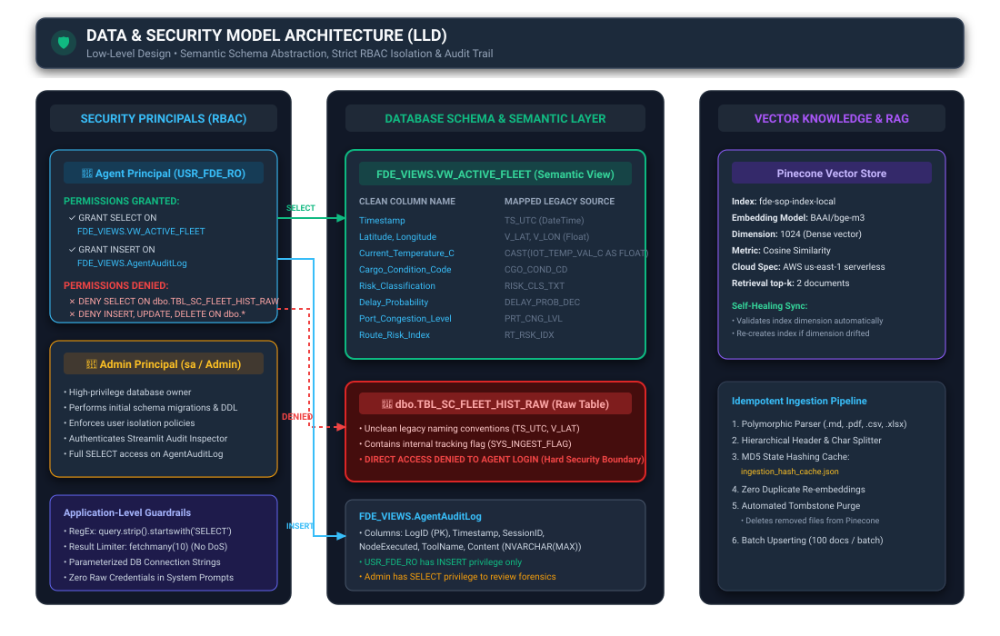
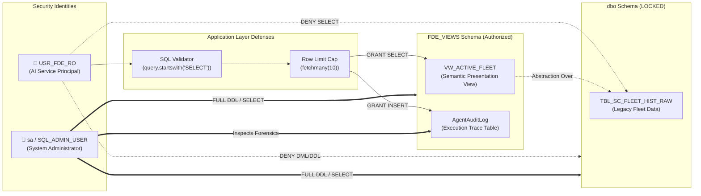

# 🧊 Cold Chain Logistics: Enterprise AI Telemetry & Dispatch Assistant

[](https://www.python.org/)
[](https://langchain-ai.github.io/langgraph/)
[](https://ai.google.dev/)
[](https://www.pinecone.io/)
[](https://www.microsoft.com/sql-server)
[](https://streamlit.io/)

---

## 📋 Table of Contents
1. [Problem Statement](#-problem-statement)
2. [System Architecture (HLD)](#-system-architecture-hld)
   - [High-Level Overview](#high-level-overview)
   - [Architecture Diagram](#architecture-diagram)
   - [Component Decomposition](#component-decomposition)
3. [Agent Orchestration (LLD)](#-agent-orchestration-lld)
   - [State Machine Design](#state-machine-design)
   - [Orchestration Flow Diagram](#orchestration-flow-diagram)
   - [LangGraph State & Node Definitions](#langgraph-state--node-definitions)
   - [The "Domino Effect" Multi-Tool Chaining](#the-domino-effect-multi-tool-chaining)
   - [Enforced Business Reporting Format](#enforced-business-reporting-format)
4. [Data & Security Model (LLD)](#-data--security-model-lld)
   - [Data Architecture & Security Boundary](#data-architecture--security-boundary)
   - [Semantic Layer & Schema Mapping](#semantic-layer--schema-mapping)
   - [Role-Based Access Control (RBAC)](#role-based-access-control-rbac)
   - [Application-Level Defenses & SQL Injection Mitigation](#application-level-defenses--sql-injection-mitigation)
   - [Knowledge Base & Idempotent Vector Pipeline](#knowledge-base--idempotent-vector-pipeline)
   - [Enterprise Audit Trail Architecture](#enterprise-audit-trail-architecture)
5. [Technology Stack](#-technology-stack)
6. [Repository Structure](#-repository-structure)
7. [Installation & Setup Guide](#-installation--setup-guide)
8. [Verification & Test Scenarios](#-verification--test-scenarios)
9. [Future Roadmap](#-future-roadmap)

---

## 🎯 Problem Statement

Modern cold-chain logistics operations transport billions of dollars in temperature-sensitive cargo (pharmaceuticals, biologicals, fresh perishables, seafood, and vaccines). Maintaining strict temperature compliance across multi-modal transit corridors—such as the high-density Southern California / Port of Long Beach / Inland Empire logistics networks—is mission-critical. A temperature spike exceeding $4.0^\circ\text{C}$ for fresh perishables can cause total cargo spoilage, regulatory penalties, and significant financial liability.

### The Client's Dilemma: "Talking to Legacy Data"
The enterprise client operates a massive, legacy **Microsoft SQL Server** data warehouse storing continuous IoT fleet telemetry (`TBL_SC_FLEET_HIST_RAW`). While this database captures real-time refrigerated container (reefer) temperatures, GPS coordinates, delay probabilities, and port congestion levels, it presents severe operational roadblocks:

```
+----------------------------------------------------------------------------------------------------+
|                                    THE ENTERPRISE CHALLENGES                                       |
+----------------------------------------------------------------------------------------------------+
| 1. Cryptic Legacy Schemas: Columns have unintuitive abbreviations (TS_UTC, V_LAT, V_LON,          |
|    IOT_TEMP_VAL_C, CGO_COND_CD, PRT_CNG_LVL, RT_RSK_IDX) that non-technical dispatchers cannot    |
|    query or interpret during high-stress transit emergencies.                                      |
|                                                                                                    |
| 2. The Multi-Source Context Gap: SQL data alone is blind. A reefer temperature alert is meaningless|
|    without knowing:                                                                                |
|    - Is an external heat wave or severe windstorm disrupting the transit corridor?                |
|    - What specific Standard Operating Procedure (SOP) governs this cargo type?                    |
|    - Should the driver restart the auxiliary cooling unit or divert to an overflow depot?          |
|                                                                                                    |
| 3. Security, Hallucination & Mutation Risks: Giving an LLM direct administrative SQL access risks  |
|    catastrophic DDL/DML mutations (DROP, DELETE, UPDATE), SQL injections, table locking, or       |
|    hallucinated joins across unverified enterprise databases.                                      |
+----------------------------------------------------------------------------------------------------+
```

### The Solution
This platform introduces an **Enterprise Agentic Decision System** powered by **LangGraph** and **Google Gemini 3.8 Flash**. It bridges the gap between natural language business inquiries and the client's legacy database by:
1. **Translating natural language queries into verified T-SQL** via a curated semantic layer (`FDE_VIEWS.VW_ACTIVE_FLEET`).
2. **Synthesizing multi-modal telemetry**: Fusing internal SQL fleet data with external real-time ambient weather (Open-Meteo REST API) and corporate compliance policies (Pinecone Serverless Vector RAG).
3. **Enforcing Zero-Trust RBAC**: Locking down the legacy database behind strict read-only least-privilege credentials while streaming an immutable execution audit trail to `FDE_VIEWS.AgentAuditLog`.

---

## 🏛️ System Architecture (HLD)

### High-Level Overview
The system follows a tiered, event-driven architecture that separates the user presentation surface, the cognitive agentic orchestration runtime, external operational tools, and isolated persistent storage systems.

### Architecture Diagram



#### Native Flow Architecture (HLD)


### Component Decomposition

| Component | Technology | Primary Role |
| :--- | :--- | :--- |
| **Dispatch Console & Audit HUD** | Streamlit 1.66+ | Multi-user interface providing real-time token streaming, reactive intent badges, collapsible parameter inspection accordions, and an authenticated administrative audit trail viewer. |
| **Agent Orchestrator** | LangGraph 1.2+ | Manages the conversation state machine, executes cyclic tool-reasoning loops, maintains thread memory, and enforces deterministic exit criteria. |
| **Cognitive Reasoner** | Google Gemini 3.8 Flash | Function-calling LLM operating at zero temperature for deterministic, analytical query formulation and business response generation. |
| **Semantic Telemetry Tool** | SQLAlchemy + pyodbc | Bridges natural language to T-SQL, enforcing `SELECT`-only execution on the abstracted semantic view while capping output row counts. |
| **Live Corridor Weather Tool** | Open-Meteo REST API | Queries live ambient temperature, wind velocity, and computes the dynamic transit corridor disruption index for vehicle GPS coordinates. |
| **Compliance SOP Retriever** | Pinecone + HuggingFace | Serverless vector database storing chunked Standard Operating Procedures embedded via `BAAI/bge-m3` in a 1024-dimensional space. |
| **Enterprise Database** | MS SQL Server 2022 | Enterprise relational database hosting raw legacy fleet logs and the isolated `FDE_VIEWS` security schema. |

---

## ⚙️ Agent Orchestration (LLD)

### State Machine Design
The agent is modeled as a compiled **LangGraph `StateGraph`** with cyclic re-act (Reason + Act) execution capabilities. It handles complex, multi-hop operational queries through progressive context gathering.

### Orchestration Flow Diagram



#### State Transition Sequence


### LangGraph State & Node Definitions

#### 1. `AgentState`
The execution context is typed using Python's `TypedDict` and LangGraph's `add_messages` reducer:
```python
class AgentState(TypedDict):
    messages: Annotated[list[BaseMessage], add_messages]
```
- Every user input, intermediate tool call, tool response, and final synthesis is appended chronologically.
- `MemorySaver` checkpointer indexes the graph state against a unique `thread_id` UUID, ensuring multi-turn conversational persistence per dispatcher session.

#### 2. The `reasoner` Node
- Evaluates the accumulated conversation history against the system prompt.
- Dynamically generates tool execution arguments or synthesizes the final business response.
- Equipped with zero temperature to prevent hallucinations in mission-critical logistics scenarios.

#### 3. The `tools` Node
- Encapsulates `ToolNode([query_telemetry_db, fetch_corridor_conditions, search_compliance_sop])`.
- Automatically unpacks function call specifications emitted by Gemini, invokes the relevant external SDK or connection pool, and wraps results inside `ToolMessage` payloads.

#### 4. The `tools_condition` Edge
- Inspects the latest message in `AgentState`.
- If `tool_calls` are present $\rightarrow$ routes to `tools`.
- If no `tool_calls` are present $\rightarrow$ routes to `END`.

### The "Domino Effect" Multi-Tool Chaining
When a dispatcher asks a complex query:
> *"Find active shipments near Los Angeles. Check local weather, and tell me if the current cargo temperature violates the SOP for fresh perishables."*

The orchestrator executes an automated 3-step domino sequence without manual user intervention:
1. **Domino 1 (`query_telemetry_db`)**: Queries `VW_ACTIVE_FLEET` to identify trucks near LA coordinates ($\approx 33.8, -118.1$), retrieving current cargo temperature ($4.8^\circ\text{C}$).
2. **Domino 2 (`fetch_corridor_conditions`)**: Extracts vehicle coordinates from Domino 1 and calls the Open-Meteo REST API, determining external ambient temperature ($32.4^\circ\text{C}$) and severe wind conditions.
3. **Domino 3 (`search_compliance_sop`)**: Recognizes the cargo type and queries the Pinecone vector index for *"Fresh Perishables"*, retrieving the strict $4.0^\circ\text{C}$ threshold and mitigation actions.
4. **Synthesis**: Correlates that the internal temperature ($4.8^\circ\text{C}$) exceeds the SOP ceiling ($4.0^\circ\text{C}$), aggravated by high external heat ($32.4^\circ\text{C}$), and prescribes the mandatory auxiliary cooling restart and depot diversion.

### Enforced Business Reporting Format
The system prompt mandates a clean, 3-part operational report structure, suppressing raw JSON:

```markdown
### 1. Executive Summary
* [1-2 sentences summarizing the core anomaly or situation.]
* [State the immediate operational risk.]

### 2. Telemetry & Environment Analysis
| Location (Lat/Lon) | Current Temp | Cargo Risk | Weather / Congestion |
| :--- | :--- | :--- | :--- |
| [Data] | [Data] | [Data] | [Data] |

*Analysis:* [1 brief sentence explaining if the environment or equipment caused the anomaly.]

### 3. Required Action Plan
1. **[Immediate Step 1]**: [Action derived from SOP]
2. **[Immediate Step 2]**: [Action derived from SOP]

*SOP Compliance Citation:* [Cite exact document version and section driving the action plan]
```

---

## 🔒 Data & Security Model (LLD)

### Data Architecture & Security Boundary



#### Security Boundary & RBAC Matrix


### Semantic Layer & Schema Mapping
The underlying legacy table contains abbreviated column names and raw datatypes. The semantic view abstracts these into intuitive business terms:

| Legacy Source (`dbo.TBL_SC_FLEET_HIST_RAW`) | Semantic View (`FDE_VIEWS.VW_ACTIVE_FLEET`) | Data Type | Business Description |
| :--- | :--- | :--- | :--- |
| `TS_UTC` | `[Timestamp]` | `DATETIME` | UTC timestamp of fleet telemetry transmission |
| `V_LAT` | `[Latitude]` | `FLOAT` | Real-time vehicle GPS latitude coordinate |
| `V_LON` | `[Longitude]` | `FLOAT` | Real-time vehicle GPS longitude coordinate |
| `IOT_TEMP_VAL_C` | `[Current_Temperature_C]` | `FLOAT` (Casted) | Reefer cargo container internal temperature in $^\circ\text{C}$ |
| `CGO_COND_CD` | `[Cargo_Condition_Code]` | `VARCHAR(50)` | Product condition code (e.g. PERISHABLE_FRESH) |
| `RISK_CLS_TXT` | `[Risk_Classification]` | `VARCHAR(50)` | Transit risk rating (e.g. Low, Moderate, High Risk) |
| `DELAY_PROB_DEC` | `[Delay_Probability]` | `FLOAT` | Machine-learned probability of SLA delivery delay ($0.0 - 1.0$) |
| `PRT_CNG_LVL` | `[Port_Congestion_Level]` | `FLOAT` | Corridor / port bottleneck index ($1.0 - 10.0$) |
| `RT_RSK_IDX` | `[Route_Risk_Index]` | `FLOAT` | Composite weather and route hazard index ($1.0 - 10.0$) |
| `SYS_INGEST_FLAG` | *Omitted from View* | `VARCHAR(1)` | Internal data engineering pipeline ingestion flag |

### Role-Based Access Control (RBAC)
Database-level security is enforced via SQL Server logins, users, and explicit grant/deny statements in [`setup_security_view.sql`](scripts/setup_security_view.sql):

```sql
-- 1. Create isolated AI Agent Login & User
CREATE LOGIN USR_FDE_RO WITH PASSWORD = 'AgentPassword2026!';
CREATE USER USR_FDE_RO FOR LOGIN USR_FDE_RO;
GO

-- 2. Principle of Least Privilege: Allow access ONLY to the semantic view
GRANT SELECT ON FDE_VIEWS.VW_ACTIVE_FLEET TO USR_FDE_RO;

-- 3. Hard Security Boundary: Explicitly DENY access to the raw table and schema
DENY SELECT ON dbo.TBL_SC_FLEET_HIST_RAW TO USR_FDE_RO;
DENY INSERT, UPDATE, DELETE, ALTER ON SCHEMA::dbo TO USR_FDE_RO;
GO

-- 4. Audit Logging Permission: Grant INSERT only to the Audit Table
GRANT INSERT ON FDE_VIEWS.AgentAuditLog TO USR_FDE_RO;
GO
```

### Application-Level Defenses & SQL Injection Mitigation
To protect against prompt injections and malicious query crafting:
1. **Keyword Sanitization**: The database tool strictly verifies that queries begin with `SELECT`:
   ```python
   if not sql_query.strip().upper().startswith("SELECT"):
       return "SECURITY BLOCK: Only SELECT operations are authorized on this view."
   ```
2. **Denial-of-Service (DoS) Protection**: Unbounded scans are thwarted by enforcing `cursor.fetchmany(10)`, guaranteeing the LLM cannot cause memory starvation or crash the database engine.
3. **Environment Isolation**: Database credentials for the agent (`USR_FDE_RO`) are physically separated in `.env` from administrative credentials (`sa` / `SQL_ADMIN_USER`).

### Knowledge Base & Idempotent Vector Pipeline
Enterprise SOPs ([`Cold_Chain_Incident_SOP_v2.md`](data/policy/Cold_Chain_Incident_SOP_v2.md)) are indexed into a **Pinecone Serverless** vector index via [`sop_ingest.py`](scripts/sop_ingest.py):

```
+----------------------------------------------------------------------------------------------------+
|                                 POLYMORPHIC INGESTION PIPELINE                                     |
+----------------------------------------------------------------------------------------------------+
|                                                                                                    |
|  [Source Files: .md, .pdf, .csv, .xlsx, .txt]                                                      |
|         │                                                                                          |
|         ▼                                                                                          |
|  [MD5 Hash Check] ──(Match)──> [✨ Skipped: Zero Redundant Vectorization]                         |
|         │ (Modified / New)                                                                         |
|         ▼                                                                                          |
|  [Document Parsing & Hierarchical Chunking]                                                        |
|  (MarkdownHeaderTextSplitter + RecursiveCharacterTextSplitter: chunk_size=600, overlap=60)        |
|         │                                                                                          |
|         ▼                                                                                          |
|  [Local Embeddings Generation]                                                                     |
|  (BAAI/bge-m3 Model, 1024-Dimension Space, Cached in Global RAM)                                   |
|         │                                                                                          |
|         ▼                                                                                          |
|  [Batched Vector Upsert] ──> [Pinecone Index: fde-sop-index-local]                                  |
|         │                                                                                          |
|         ▼                                                                                          |
|  [Automated Tombstone Pruning] (Purges deleted files from Pinecone index automatically)            |
+----------------------------------------------------------------------------------------------------+
```

### Enterprise Audit Trail Architecture
Every node transition, tool call payload, tool result, and generated synthesis is captured in `FDE_VIEWS.AgentAuditLog`:

```sql
CREATE TABLE FDE_VIEWS.AgentAuditLog (
    LogID INT IDENTITY(1,1) PRIMARY KEY,
    Timestamp DATETIME DEFAULT GETDATE(),
    SessionID VARCHAR(50),
    NodeExecuted VARCHAR(50),
    ToolName VARCHAR(100),
    Content NVARCHAR(MAX)
);
```

- **Zero-Friction Logging**: The agent writes traces asynchronously during normal reasoning execution.
- **Admin Dashboard**: The Streamlit HUD features an administrative authentication gate where supervisors input `SQL_ADMIN_USER` credentials to view immutable forensic traces.

---

## 💻 Technology Stack

| Category | Component | Specification |
| :--- | :--- | :--- |
| **Language & Runtime** | Python | `>= 3.14` |
| **Package Management** | uv / pip | `pyproject.toml` |
| **Agent Framework** | LangGraph & LangChain | `langgraph>=1.2.18`, `langchain-community>=0.4.2` |
| **Large Language Model** | Google Gemini | `gemini-3.8-flash` via `langchain-google-genai` |
| **Embeddings Model** | BAAI / HuggingFace | `BAAI/bge-m3` (1024 Dimensions, CPU inference) |
| **Vector Database** | Pinecone | Serverless AWS `us-east-1`, cosine similarity metric |
| **Relational Database** | Microsoft SQL Server | SQL Server 2022 on Docker (`mcr.microsoft.com/mssql/server`) |
| **Database Connector** | SQLAlchemy & pyodbc | ODBC Driver 18 for SQL Server |
| **Live Telemetry API** | Open-Meteo REST API | Global weather & corridor congestion service |
| **Web UI Framework** | Streamlit | Custom Dark Theme HUD (`streamlit>=1.66.1`) |

---

## 📂 Repository Structure

```
Cold Chain Logistics/
├── .env                                       # Local environment variables (API keys, SQL logins)
├── pyproject.toml                             # Project build metadata and dependencies
├── README.md                                  # Enterprise architectural and operational documentation
├── data/
│   ├── cache/
│   │   └── ingestion_hash_cache.json          # MD5 vector hash tracking for zero-duplicate ingestion
│   ├── policy/
│   │   └── Cold_Chain_Incident_SOP_v2.md      # Standard Operating Procedure compliance documents
│   ├── raw/
│   │   └── dynamic_supply_chain_logistics_dataset.csv  # Raw fleet telemetry data source
│   └── source/
│       └── data.txt                           # Dataset source repository link
├── docs/
│   ├── instrutions.md                         # Detailed phased operational instructions
│   └── images/                                # Architectural SVG diagrams & visual artifacts
│       ├── system_architecture_hld.svg        # System Architecture (HLD) Diagram
│       ├── agent_orchestration_lld.svg        # Agent Orchestration (LLD) Diagram
│       └── data_security_model_lld.svg        # Data & Security Model (LLD) Diagram
├── scripts/
│   ├── check_index.py                         # Diagnostic script for Pinecone index health
│   ├── data_ingest.py                         # Ingestion pipeline: CSV -> Docker MSSQL dbo table
│   ├── generate_diagrams.py                   # Programmatic SVG architecture diagram generator
│   ├── setup_security_view.sql                # DDL script creating FDE_VIEWS, RBAC users & views
│   └── sop_ingest.py                          # Incremental polymorphic RAG ingestion pipeline
└── src/
    ├── prompts/
    │   └── system_prompt.txt                  # Enforced Senior Data Scientist operational instructions
    └── cold_chain_logistics/
        ├── __init__.py
        ├── agent_tools.py                     # LangChain tool implementations (DB, REST, Pinecone)
        ├── orchestrator.py                    # LangGraph StateGraph compiled agentic state machine
        └── ui.py                              # Streamlit enterprise HUD & security audit console
```

---

## 🚀 Installation & Setup Guide

### Phase 0: Environment & Infrastructure

#### 1. Clone the repository and initialize the Python environment:
```powershell
# Using uv (recommended)
uv venv .venv
.\.venv\Scripts\activate

# Install dependencies
uv pip install -e .
```

#### 2. Configure Environment Variables (`.env`):
Create a `.env` file in the project root:
```ini
# Google Gemini LLM API Key
GOOGLE_API_KEY="your-google-api-key"

# Pinecone Vector Store
PINECONE_API_KEY="your-pinecone-api-key"
LOCAL_EMBEDDING_MODEL="BAAI/bge-m3"

# Microsoft SQL Server Configuration
SQL_SERVER_HOST="localhost"
SQL_SERVER_PORT="1433"

# Administrative Credentials (Schema Setup & Audit Review)
SQL_ADMIN_USER="sa"
SQL_ADMIN_PASSWORD="FdeEnterprisePass123!"

# AI Agent Service Principal (Least Privilege)
SQL_AGENT_USER="USR_FDE_RO"
SQL_AGENT_PASSWORD="AgentPassword2026!"
```

#### 3. Spin up the Legacy MSSQL Docker Container:
```powershell
docker run -e "ACCEPT_EULA=Y" `
    -e "MSSQL_SA_PASSWORD=FdeEnterprisePass123!" `
    -p 1433:1433 `
    --name legacy-mssql `
    -d mcr.microsoft.com/mssql/server:2022-latest
```

#### 4. Ingest Raw Telemetry Data:
```powershell
python scripts/data_ingest.py
```

---

### Phase 1: Vector Knowledge Base Ingestion

#### 1. Ingest Corporate Compliance SOPs:
```powershell
python scripts/sop_ingest.py
```

#### 2. Verify Pinecone Index Statistics:
```powershell
python scripts/check_index.py
```

---

### Phase 2: Database Security & RBAC Configuration

Execute the security script [`setup_security_view.sql`](scripts/setup_security_view.sql) in your SQL client (Azure Data Studio, VS Code MSSQL extension, or `sqlcmd`) using the `sa` login:
```sql
-- Connect as sa / FdeEnterprisePass123! to localhost:1433
-- Run scripts/setup_security_view.sql
```

Create the audit log table and grant agent write access:
```sql
CREATE TABLE FDE_VIEWS.AgentAuditLog (
    LogID INT IDENTITY(1,1) PRIMARY KEY,
    Timestamp DATETIME DEFAULT GETDATE(),
    SessionID VARCHAR(50),
    NodeExecuted VARCHAR(50),
    ToolName VARCHAR(100),
    Content NVARCHAR(MAX)
);

GRANT INSERT ON FDE_VIEWS.AgentAuditLog TO USR_FDE_RO;
```

---

### Phase 3: Launch the Application

#### Option A: Interactive Streamlit HUD (Recommended)
```powershell
streamlit run src/cold_chain_logistics/ui.py
```
Open your browser at `http://localhost:8501`.

#### Option B: Terminal CLI Dispatcher
```powershell
python src/cold_chain_logistics/orchestrator.py
```

---

## 🧪 Verification & Test Scenarios

### Scenario 1: The "Domino Effect" Multi-Hop Test
* **Objective**: Validate automated chaining across SQL Database $\rightarrow$ Live Weather REST API $\rightarrow$ Pinecone Vector SOP.
* **Dispatcher Prompt**:
  ```text
  Find any active shipments near Los Angeles (Latitude ~33.8, Longitude ~-118.1). Check the local weather there, and tell me if the current cargo temperature violates the SOP for fresh perishables.
  ```
* **Expected Outcome**:
  1. Intent recognized: `query_telemetry_db` $\rightarrow$ retrieves vehicle at Lat: 33.77, Lon: -118.19 with temp $4.8^\circ\text{C}$.
  2. Intent recognized: `fetch_corridor_conditions` $\rightarrow$ calls Open-Meteo for Lat: 33.77, Lon: -118.19.
  3. Intent recognized: `search_compliance_sop` $\rightarrow$ fetches fresh perishables threshold ($4.0^\circ\text{C}$).
  4. Generates structured 3-part report declaring a Critical Cold-Chain Breach and recommending immediate auxiliary cooling restart.

---

### Scenario 2: The "Restraint" No-Tool Routing Test
* **Objective**: Verify that conversational and general policy questions do not trigger redundant database or API calls.
* **Dispatcher Prompt**:
  ```text
  I'm a new dispatcher on the night shift. Can you quickly explain the difference between a Tier 1 and Tier 2 escalation?
  ```
* **Expected Outcome**:
  - The `tools_condition` router identifies zero tool calls required.
  - The agent responds conversationally and immediately from contextual knowledge without invoking the database or external APIs.

---

### Scenario 3: Zero-Trust RBAC Enforcement Test
* **Objective**: Confirm that the AI agent user is strictly forbidden from querying the underlying legacy table.
* **Test Commands** (using `USR_FDE_RO` login):
  ```sql
  -- Test A: Authorized Semantic View (SHOULD SUCCEED)
  SELECT TOP 5 * FROM FDE_VIEWS.VW_ACTIVE_FLEET;

  -- Test B: Direct Raw Table Query (MUST FAIL INSTANTLY)
  SELECT TOP 5 * FROM dbo.TBL_SC_FLEET_HIST_RAW;
  ```
* **Expected Result for Test B**:
  `Msg 229, Level 14, State 5: The SELECT permission was denied on the object 'TBL_SC_FLEET_HIST_RAW', database 'master', schema 'dbo'.`

---

### Scenario 4: Admin Audit Log Forensics Inspection
1. Open the Streamlit sidebar and toggle **"🛡️ Security & Audit Logs"**.
2. Authenticate using `SQL_ADMIN_USER` credentials (`sa` / `FdeEnterprisePass123!`).
3. Inspect chronological logs showing `SessionID`, `NodeExecuted` (`reasoner`, `tools`, `reasoner_final`), `ToolName`, and full raw payload JSONs.

---

## 🔮 Future Roadmap

- [ ] **Automated Vehicle Telematics Interventions**: Implement IoT bidirectional MQTT triggers allowing the agent to automatically command reefer auxiliary cooling restarts upon dispatcher confirmation.
- [ ] **Predictive Spoilage Forecasting**: Integrate LSTM / XGBoost models into the tool chain to forecast reefer temperature rise rates based on solar radiation and route gradients.
- [ ] **Multi-Region Geofencing**: Expand vector SOP indexes across interstate corridors (I-5, I-10, I-15) with dynamic state-specific agricultural and pharmaceutical transport compliance regulations.
- [ ] **Automated PDF Incident Reports**: Generate digitally signed PDF incident reports with cryptographic SHA-256 audit hashes for regulatory compliance submissions.

---

## 📄 License & Maintainers
* **Author**: Somya Jagati ([somyajagati@gmail.com](mailto:somyajagati@gmail.com))
* **Repository**: [Cold Chain Logistics FDE Project](https://github.com/nimowhyca/cold-chain-logistics-FDE-Project)
* **License**: MIT Enterprise License

